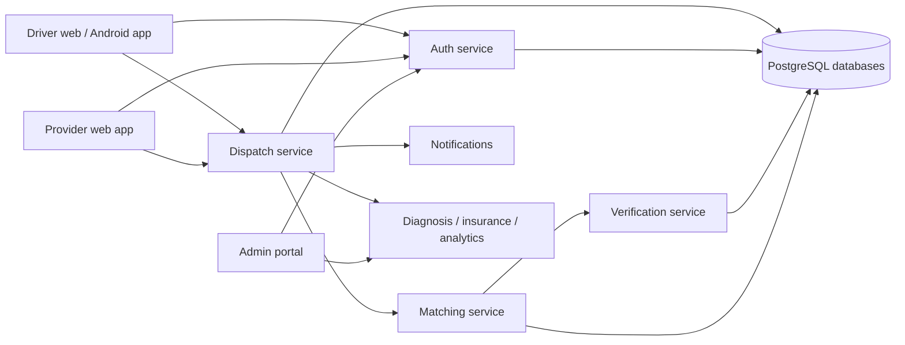

# MOTOFIX project analysis

**Reviewed:** 18 November 2026  
**Repository:** `D:\New folder\motofix`  
**Revision:** `827ae77` on `main` (`origin/main`)  
**Working tree:** clean at review time

## Executive assessment

MOTOFIX is a substantial Uganda-focused roadside-assistance platform. The codebase contains three web clients, Android packaging for the driver app, and FastAPI services for identity, provider verification, request dispatch, matching, notifications, analytics, diagnosis, insurance, and shared utilities. The most complete core is the driver-to-provider request lifecycle, with PostgreSQL persistence and WebSocket updates. This is beyond a static prototype, but repository presence alone does not establish that integrations are configured, the stack starts cleanly, payments settle correctly, or the product is production-ready.

The clearest strengths are the breadth of the end-to-end product, a distinct provider-verification/matching flow, persisted operational records, explicit feature flags, and CI workflows for backend tests plus web and Android builds. The highest-priority weaknesses are operational reproducibility, outdated runbooks, production security defaults, and limited end-to-end validation. In particular, the checked-in Compose file references multiple ignored per-service `.env` files that are absent from this checkout, and the root `.env.example` described by the README is also absent. A clean developer cannot follow the documented one-command startup as written.

**Overall maturity:** promising MVP / pilot codebase; not yet demonstrably production-ready from this repository review. No services, builds, or tests were run for this analysis.

## Product and scope

The product aims to connect a stranded driver with a verified nearby mechanic or towing provider, then support the request through arrival, job updates, payment, and feedback. Supporting features include provider applications and review, admin oversight, notifications, spare-parts discovery, fuel guidance, insurance records, and AI-assisted vehicle diagnosis.

The checkout is on `main`, whose latest commit is `v1 has no mechanic app`; that commit changes only the provider app's Vite configuration. The provider app is still present in this checkout and in Compose/CI. `RELEASE_V1.md` describes a separate `release/v1` driver-first launch branch, while the root README and much of the source describe the broader product. Treat branch and release scope as explicit: this analysis describes the checked-out `main`, not a deployed V1 build.

## Architecture map

| Layer | Current implementation | Assessment |
|---|---|---|
| Driver client | React, TypeScript, Vite, Capacitor; request, location, status, payment and support views | Broad client surface; Android is generated/built by CI. Runtime API configuration is baked into Vite builds. |
| Provider client | Separate React/Vite application for provider jobs, availability, profile and earnings | Present in `main`; `RELEASE_V1.md` says it is deferred for V1. |
| Admin client | React/Vite portal for operational oversight and reporting | Separate build workflow; relies on several API base URLs. |
| Backend | FastAPI services: auth, dispatch, verification, matching, analytics, insurance, diagnosis, and core; notifications nested under analytics | Clear domain intent, but boundaries and deployment configuration are not fully aligned. |
| Persistence | PostgreSQL instance with a database per domain; dispatch and matching use `asyncpg`/SQL; some services use SQLAlchemy/Alembic | Data ownership is mostly separated, but services exchange data across boundaries and analytics reads multiple service databases. |
| Real time | Dispatch owns WebSockets for job/status/location updates | The backend and clients contain meaningful real-time logic; reliability under reconnects and concurrent state changes needs integration validation. |
| Deployment | Docker Compose for the local full stack; GitHub Actions for backend checks and separate UI/Android builds | Good starting automation; Compose setup is not reproducible from the checked-in env templates. |

The dispatch service is the operational center and owns requests, media references, chat, fee ledger, payment records, feature flags, reviews, and parts/dealer data. Its `app/main.py` combines lifecycle, schema changes, request APIs, WebSocket handling, fees, and payment integrations in one large module. Authentication also has a broad surface with users, provider applications, OTP, admin, catalog, and rate-limit data. This concentration makes changes harder to review and increases the chance that state transitions or permissions diverge between clients.

## What appears implemented

- **Identity and onboarding:** phone/OTP driver login, provider/admin auth paths, provider application and verification data, JWT issuance, and token blacklist support.
- **Request and fulfillment:** driver requests, area/GPS details, matching calls, provider acceptance/rejection, status updates, cancellation, media, chat, and review concepts are represented in backend and UI code.
- **Matching:** a dedicated service fetches verified/available providers, skips prior dispatch attempts, ranks candidates, and records outcomes. A launch-area fallback is supported in addition to the more general scoring logic.
- **Payments and fees:** dispatch contains MTN MoMo and Airtel request/transfer code, callbacks, payment records, and a platform-fee ledger. A code path is not proof of valid live merchant configuration or successful settlement/reconciliation.
- **AI and convenience:** diagnosis endpoints include text, guided, image, chat, and transcription paths. Fuel/dealer data also appears partly bundled/static. Diagnosis is gated by a driver-side feature flag; `VITE_MOTOBOT_ENABLED` must equal `true` to expose it.
- **Admin and operations:** provider management, requests, payment/analytics pages, and notification surfaces are present in the UI and service folders.
- **Android:** an Actions workflow builds the driver web bundle, syncs Capacitor, and creates debug APK artifacts; release signing is conditional on configured secrets.

Insurance should be treated as an application/claims workflow unless live insurer integrations are separately demonstrated. Likewise, maps, SMS, push, AI vendors, payment callbacks, and mobile-money settlement depend on valid environment configuration and external accounts.

## Main risks and gaps

### P0 — A clean checkout cannot follow the documented Compose setup

`docker-compose.yml` declares `env_file` paths such as `services/motofix-auth-service/.env`, dispatch, matching, diagnosis, analytics, insurance, notifications, and core. These files are ignored by Git and none are present in this checkout. The README tells the user to copy a root `.env.example`, but that file is missing too. Only a subset of folders has tracked `.env.example` templates. As configured, Compose startup will fail on missing required env files before the platform is usable. The run instructions and provided configuration need to agree, with safe templates and explicit secret setup.

### P1 — Production-dangerous database defaults

Compose sets the Postgres superuser password to the literal `password` and publishes Postgres on host port `5433` without binding to localhost. Backend ports are also published directly. This may be tolerable for a private development machine, but it is unsafe as a production deployment baseline and should not be copied into an exposed host environment. Use secret-driven credentials, private networking, least-privilege DB roles, and limit public ingress to a TLS reverse proxy.

### P1 — Long-lived driver JWTs increase account exposure

`services/motofix-auth-service/app/utils.py` defaults non-admin token lifetime to 87,600 hours (ten years), consistent with the V1 document's explicit no-inactivity-expiry policy. This favors low-friction use but gives a stolen token a long validity window. The blacklist table is a useful building block, but the actual revocation path, expiry cleanup, device/session controls, and key rotation should be checked together. Prefer a short-lived access token plus refresh/revocation policy before a broad production launch.

### P1 — Operational docs are materially stale

`docs/RUNBOOK.md` describes an older service topology: it lists a separate payment service on port 8003 and a different set of folders/databases. In the current Compose file, matching owns 8003, insurance owns 8006, and payments are part of dispatch on 8001. The runbook's database names and service startup guidance therefore cannot be trusted for this revision. The README service map is closer, but it still claims a root env template that is absent. Update the runbook from the actual Compose/service configuration and mark branch-specific instructions clearly.

### P1 — No demonstrated production deployment or full-stack acceptance

The repository contains local Compose and build workflows, but this review did not find evidence here of a deployed environment, production smoke results, or end-to-end acceptance across driver, provider, backend, and payment callback. Request lifecycle, reconnects, duplicate callbacks, race conditions around acceptance/cancellation, and payment reconciliation are exactly where isolated unit tests are insufficient.

### P2 — Domain logic and schema changes are concentrated

Dispatch contains a large, mixed-responsibility module and performs substantial table creation/alteration at startup. Auth also has broad schema and route responsibility. This increases startup coupling and makes safe migration/rollback, transactional boundaries, and ownership harder to reason about. Move toward reviewed versioned migrations, explicit domain modules, and idempotent state transitions for critical flows.

### P2 — Test coverage is narrow relative to feature count

There are Python tests across auth, verification, matching, diagnosis, dispatch, analytics, and notifications, and workflows build the admin/provider apps and driver Android artifact. There are no tracked service test suites for insurance or core, and no meaningful automated browser-to-backend acceptance suite is apparent. CI should add schema migration tests, dispatch/payment integration cases, and at least one production-like request lifecycle test. This is a static inventory; no tests were executed.

### P2 — Configuration and country-specific payment defaults need a launch gate

Compose's fallback MTN sandbox currency is `EUR`, while the product targets Uganda and the dispatch implementation supports UGX in production. Ensure the release environment explicitly sets Uganda production values and tests the network's callback/disbursement configuration; do not treat successful frontend payment screens or sandbox API responses as proof of collected and reconciled UGX funds.

## What is working in the project design

- The product is organized around a real user problem with three clear actors: driver, provider, and operations/admin.
- Provider verification is a first-class domain rather than an informal UI-only concept.
- Matching has a separate service, records dispatch attempts, and includes an area-based launch fallback useful where accurate GPS is unavailable.
- The driver interface is designed to keep the request flow useful even when optional map/AI features are disabled, according to the V1 scope document.
- The code includes explicit operational features such as health endpoints, startup recovery scripts, database separation, WebSocket reconnection/watchdog behavior, and an Android build artifact workflow.
- `.gitignore` excludes local environment files and service-account/private-key patterns, which is appropriate; the missing tracked templates are the usability cost of that protection.

## Recommended next steps, in order

1. **Make local startup reproducible:** add/restore root and per-service env templates, remove hard-coded credentials, make optional service env files optional or generate them from documented templates, and verify one clean-machine Compose startup.
2. **Replace the runbook with the current service map:** reconcile service names, ports, database names, required variables, migration behavior, health checks, and the actual V1-vs-main branch instructions.
3. **Set a production security baseline:** secret-managed DB credentials, private Postgres, TLS ingress, least-privilege DB users, explicit CORS origins, provider/admin authorization review, safe file-upload limits/storage, and a shorter token/refresh strategy.
4. **Prove critical journeys end to end:** OTP login; request by area with no map key; matching to a verified provider; accept/decline/re-dispatch; cancellation; completion and rating; payment callback retry/idempotency; admin review. Capture evidence from a running test environment.
5. **Make data transitions auditable:** introduce versioned migrations for each service and define authoritative request/payment state transitions, idempotency keys, callback verification, and reconciliation reports.
6. **Reduce dispatch change risk:** split request lifecycle, WebSocket delivery, media/chat, fee ledger, and payments into focused modules with clear ownership and tests before additional product features.
7. **Clarify launch scope:** decide whether the target is the driver-first `release/v1` branch or the fuller `main` product; align screenshots, README, feature claims, CI, and runbooks with that exact release.

## Bottom line

MOTOFIX has a credible and broad MVP foundation, especially around driver requests, provider matching, and operational fulfillment. The code indicates substantial implementation, but the repository is not yet self-describing or reproducible enough for a new operator, and the Compose defaults should not be used on a public production host. The next value comes from fixing setup/docs, tightening auth and deployment defaults, and proving the money-and-dispatch lifecycle end to end before expanding scope.

## Evidence reviewed

- `README.md`, `RELEASE_V1.md`, `docs/RUNBOOK.md`, `docs/USER_STORIES.md`
- `docker-compose.yml`, `database/init-databases.sql`, `.github/workflows/*`
- Auth, dispatch, matching, verification, analytics, diagnosis, insurance, and core service trees
- Driver, provider, and admin frontend trees
- Git branch/status/log metadata at revision `827ae77`
